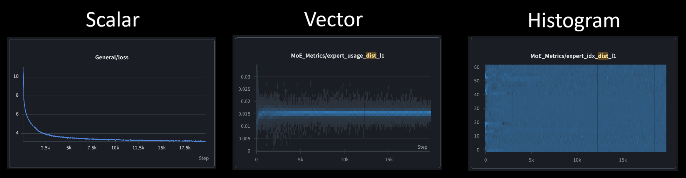

# What is this repo?

Most of my past research projects require training models from scratch. I have always opted for making the entire training loop from scratch so I know exactly what is going on everywhere. I am not a fan of trainers such as [PyTorch lightning](https://lightning.ai/docs/pytorch/stable/core-api/trainer). I should not be able to call train() and have something work.

My first Trainer was absolute garbage but got the job done. However I pretty much kept piling onto the garbage code cause why fix what isn't broken? This led to the terrible [repo](https://github.com/gmongaras/2Mamba2Furious) found in my 2Mamba2Furious paper. The code is quite bad for a lot of reasons and really embodies research code.

I wanted to rewrite my Trainer for all future projects I work on. This repo is the complete rewrite I did. Is it good code? Probably not. But I know what is going on everywhere, the code is mostly readable, and it is easy to edit.

The code is about 95% mine and 5% slop. Probably around 90% of the slop is in kernels I really couldn't bother spending a while trying to optimize. For example, the fused_enemb.py code is 100% slop. I do not know how it works nor do I care. I just cared that it was much faster than the original implementation. For almost everything else, I did care about code quality and did not want slop. I could've slopped this out in a day with cursor but then had something worse than PyTorch lightning and way less readable/understandable.

I also wanted to get evals working as submitting to any reasonable conference requires evals yet evals are very annoying to get unless you utilize some training framework, which is exactly what I am trying to avoid.

Anyway. To answer the question, "What is this repo?", it is a Trainer I mostly built for all my future pretraining research projects that I wanted to share in case others find it useful for their work.

Note that while I have an LLM optimization loop, it is not difficult to refactor the codebase for a diffusion model. I tried to keep things somewhat generic s.t. I can pretrain any type of model.


# Setup

I am assuming you have a linux machine with some GPUs. Hopefully more than 1, though the scripts work with a single GPU.

First download [python](https://www.python.org/downloads/) and [torch](https://pytorch.org/). For my setup, I am using Python 3.10.20 and torch 2.11.0 with Cuda 12.8 with A100 GPUs. I do not see why this repo wouldn't work on other GPUs and other version but who knows.

Then, create a venv for this repo with `python3 -m venv TTVenv`. Activate the venv with `source TTVenv/bin/activate` and download the necessary packages with `pip install -r requirements.txt`.

I also use wandb. Download wandb with `pip install wandb` then do `wandb login` to login to wandb.

I have performed a training run using the script described in [Model Training](#model-training). The wandb for this run is located [here](https://forge.coreweave.com/wandb/gmongaras1/Torch_Trainer/workspace) and the checkpoint is uploaded to huggingface [here](https://huggingface.co/gmongaras/Torch_Trainer_Tfm)


# Features

The current setup I have is a text-based transformer in a training loop. The base model setup comes from the small test model in [DeepSeekMoE](https://arxiv.org/abs/2401.06066) and the dataset is [fineweb](https://huggingface.co/datasets/HuggingFaceFW/fineweb). In particular, I wanted training to be efficient so I use a varlen/cu_seqlens setup.

Features listed out:
1. [Model Training](#model-training)
2. [Checkpoint Reloading](#checkpoint-reloading)
3. [Checkpoint Inference](#checkpoint-inference)
4. [Checkpoint Eval](#checkpoint-eval)
5. [Metrics and Timing](#metrics-and-timing)
6. [Layer Interface](#layer-interface)


## Model Training

Training a model on 2 GPUs can be done with the following command:
```
nnodes=1
nproc_per_node=2
model_config="Tfm"
optim_config="Tfm"
trainer_config="Tfm"
torchrun \
    --nnodes $nnodes \
    --nproc_per_node $nproc_per_node \
    --rdzv_backend c10d \
    src/train.py \
    --model_config_name $model_config \
    --optim_config_name $optim_config \
    --trainer_config_name $trainer_config
```

If all goes well, stuff will download to `cache/` and, once done, the model should begin training.

If you are on a SLURM system, you can also edit the `runjob.sh` file and launch the training script with `sbatch runjob.sh`. As training progresses, you will see a `runjob.out` file with the runs progress.

By default, the trainer runs on 2 GPUs, for 25K steps at batch size of 128*2048 and 2048 sequence length. The default model is quite small at only 200M params. It is 9 layers and has a model dim of 1280. The hyperparameters follow [DeepSeekMoE](https://arxiv.org/abs/2401.06066), except for the batch size which is smaller than the specified batch size in DeepSeekMoE. A batch size of 4 million takes 8-16 A100 80GB GPUs. All configurations can be found in `src/exp_configs.py`.

The dataloader works by greedily taking sequences and shoving them in the current batch. By default, the batch size is `128*2048` tokens with max seq len of `2048`. This means all sequences are cut to 2048. The trivial case packs 128 sequences of length 2048 into the batch, thus having a batch size of 128 sequences. However, if a sequence is smaller than the `128*2048` batch size, we can either not worry about it and have a smaller batch, keeping a batch size of 128 sequences, or train on as many sequences that we can s.t. each sequence is at most 2048 tokens and we have a batch size of `128*2048` tokens. The dataloader does the latter. As such the min number of sequences is 128 and the max number of sequence sis `128*2048` (if we somehow have `128*2048` sequences of length 1).


### Adding losses

The current script has a single loss, which can be found under the `Losses` panel in wandb. Obviously this loss is good ol' NTP. Losses are managed through an object passed through each layer, found in `src/model/Losses.py`. If you want to add another loss, doing so is quite easy and can be done so by adding the following line in the code:

```
losses.add_loss(
    loss_name="...",
    loss_value=...
    loss_weight=1.0
)
```

Note that losses can overwrite each other. If you add a loss to a layer, you likely want to differentiate said loss with a layer specific indicator such as a suffix to the name `_layer{self.layer_num}`

Let's say I wanted to add a loss to minimize the L2 norm of the attention output for whatever reason. I could do so by adding the following right before returning in `src/model/layers/Attention.py`:

```
losses.add_loss(
    loss_name=f"attn_out_norm_l{self.layer_num}",
    loss_value=torch.linalg.vector_norm(out, dim=-1).mean()
    loss_weight=0.001
)
```

Note that all losses are automatically added together with their corresponding weights and backpropped at the end of each forward pass.


## Checkpoint Reloading

If your model crashes or you want to keep training a model, you can reload the model from a checkpoint by using the `src/train_from_cp.py` script.

To restart the Tfm model from step 22_500, run the following:
```
nnodes=1
nproc_per_node=2
model_config="Tfm"
optim_config="Tfm"
trainer_config="Tfm"
torchrun \
    --nnodes $nnodes \
    --nproc_per_node $nproc_per_node \
    --rdzv_id $RANDOM \
    --rdzv_backend c10d \
    src/train_from_cp.py \
    --model_save_path "model_ckpts/Tfm/" \
    --step "22_500" \
    --reset_wandb \
    --num_devices 2
```

Most params are self explanatory. Adding the `--reset_wandb` flag resets the wandb id s.t. the wandb id for the run is different from the saved wandb id. This appears as a new instance in wandb, starting from whatever checkpoint step was saved. `--num_devices <N>` is an optional flag that can be used to change the number of devices from whatever the checkpoint was originally trained with the the new value. 


## Checkpoint Inference

Inference can be done with a pretrained checkpoint with the following:
```
python src/infer.py \
    --prompt "hello there 1 + 2 equals" \
    --model_save_path "model_ckpts/Tfm/" \
    --step 25_000 \
    --device cuda:0 \
    --num_decode_steps 100 \
    --early_stop \
    --sampling_strategy sample
```

This just performs normal inference as you would expect. The following describes each param:
- `prompt` - A string the model starts decoding from.
- `model_save_path` - Path to the checkpoint to load.
- `step` - Step number to load.
- `device` - Device to do inference on.
- `num_decode_steps` - Number of tokens to decode. Model has a hard stop when it generates this number of tokens.
- `early_stop` - If the flag is supplied, the model will stop when it hits a stop token. Otherwise, it generates until it hits `num_decode_steps`
- `sampling_strategy` - Can either be `sample` to sample each next token or `greedy` to take the token with the highest prob on each decode step.


## Checkpoint Eval

To evaluate a model on downstream evals, run the following script:
```
python src/eval.py \
    --model_save_path "model_ckpts/Tfm/" \
    --step 25_000 \
    --device cuda:0 \
    --eval_names hellaswag,piqa,arc_easy,arc_challenge,race,humaneval,mbpp,triviaqa,nq_open
```

This evaluates the 25_000 checkpoint of the Tfm model on device 0 on the specified evals. Params are as follows:
- `model_save_path` - Path to the checkpoint to load.
- `step` - Step number to load.
- `device` - Device to do inference on.
- `eval_names` - Comma separated list of registered evals. Look in the `src/eval.py` script to see all the registered evals. You can add more than are in here.

To add an eval, note that you have to specify the `score_names` which are the names of the eval scores to report, the number of shots with `num_shots` and the `task_type` as either prefill or decode.


## Metrics and Timing


### Adding metrics

Metrics are useful to debug your model. The metrics interface can be found in `src/model/Metrics.py`. Metrics can be added in any layer and can be added with the following:
```
metrics.add_metric(
    section_name="section_name", 
    metric_name="metric_name",
    metric_value=42,
    reduce_op=ReduceOp.AVG,
)
```
The code above adds a metric named `metric_name` under the section `section_name`. It is a value of 42 and the reduction op is an average. The metric name is the name of the graph that will show up in wandb and the section name is the name of the section said metric will be under in wandb. The metric value is whatever value to log this step. The reduce op is indicative of how to reduce across ranks. For example the loss should be `ReduceOp.AVG` but the total number of trained tokens should be `ReduceOp.SUM`.

The `metric_value` can be a scalar or a vector. If the value is a vector, we can plot a histogram via the following:
```
metrics.add_metric(
    section_name="section_name", 
    metric_name="histogram_metric",
    metric_value=torch.randn(10),
    reduce_op=ReduceOp.AVG,
    histogram=True,
)
```

The histogram was particularly useful for me when debugging MoE. Below shows what the graphs look like for a scalar, vector, and vector histogram:


`section_names` can be defined when initializing a `Metrics` object. The current codebase does this before each forward pass. If a section name is specified that is not specified on initialization of the object, and error will occur. By default, the `section_names` are:
- `General` - Includes info like loss and number of trained tokens.
- `Losses` - Includes all added losses from [Adding losses](#adding-losses).
- `Timing` - Includes all added timing spans as noted in [Adding timing spans](#adding-timing-spans).
- `Grad_Norm` - Includes grad norm for each param.


So that you don't have repetitive back to back `.add` calls, multiple metrics can be added at the same time like the following:
```
metrics.add_metrics(
    "section_name",
    metric_name1=Metric(...),
    metric_name2=Metric(...),
    ...
)
```
This adds `metric_name1` and `metric_name2` under the section `section_name` and is equivalent to the following:
```
metrics.add_metric(
    section_name="section_name", 
    metric_name="metric_name1",
    ...
)
metrics.add_metric(
    section_name="section_name", 
    metric_name="metric_name2",
    ...
)
```

Metrics are automatically logged to wandb when `log_dist` is called, which happens after each bwd pass.


### Adding timing spans

Timing spans allow you to see how long a section of code is taking. The timing interface can be found in `src/model/Timing.py`. A timing span must be started and ended like the following for the attn section:
```
timing.start_span("attn")

<attn code>

timing.end_span("attn")
```

When a timing span is started, the time is saved and when it ends, the total time between the start and end is saved to a vector. To get timing data, use `timing.get_span_total("span_name")` to get the additive total across the saved timings vector and `timing.get_span_avg("span_name")` to get the average across the saved timings vector.

For one off ops such as taking an optimizer step, the vector is a single scalar so the reduction doesn't do anything. If you want to profile a layer, for example attention, you likely want to see the average or total time this takes across the entire model fwd/bwd pass so you can compare it with the other layers. Thus the need for a vector reduction as the vector accumulates timings until reset, which happens before each fwd pass.

The function `get_all_span_totals` is used by the trainer to get all the span totals and log them as metrics. This way, you will see any span added with the above code appear under `Timing` in wandb.


## Layer Interface

The layer interface can be found in `src/model/layers/Layer.py`. All layers inherit from this class, mainly so one is able to independently checkpoint each layer and so the layer has the same set of inputs:
- `X` - Sequence of shape (N, d) for said layer to process.
- `cu_seqlens` - Sequence lens of shape (num_sequences+1) corresponding to the sequence lengths in X.
- `metrics` - Optional metrics as described in [Metrics and Timing](#metrics-and-timing)
- `timing` - Optional timing as described in [Metrics and Timing](#metrics-and-timing)
- `losses` - Optional losses as described in [Adding Losses](#adding-losses)
- `cache` - A dictionary that allows you to add stuff from one layer and use it in a future layer. For example, let's say I need to calculate something once for all layers and said computation is somewhat expensive and doesn't need to be differentiable. I can have the first layer do the expensive operation and add it to the cache, then all future layers can pull the cached output from the cache. Not used in this repo but it works and I found it quite useful.
- `inf_cfg` - Object used for inference as described in [Checkpoint Inference](#checkpoint-inference).

To count the number of parameters in a model, each layer reports the number of params in said layer via `num_params` and the number of active params with `num_active`. The latter being useful for layers like MoE.
